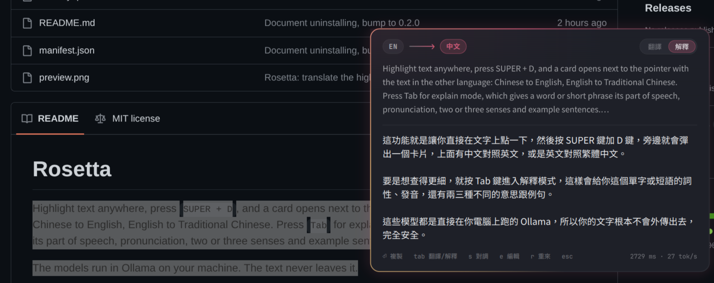

# Rosetta

Highlight text anywhere, press `SUPER + D`, and a card opens next to the pointer with the text in the other language: Chinese to English, English to Traditional Chinese. Press `Tab` for explain mode, which gives a word or short phrase its part of speech, pronunciation, two or three senses and example sentences.

The models run in Ollama on your machine. The text never leaves it.



## Keys

| Key | Does |
|---|---|
| `SUPER + D` | translate the highlighted text; press again on the same text to close |
| `SUPER + ALT + D` | open an empty input box to type or paste into (`Ctrl + V`); press again to close |
| `Enter` or `c` | copy the answer and close |
| `Ctrl + C` | copy only the part of the answer you selected |
| `Tab` | switch between translate and explain |
| `s` | swap the direction, when the language was guessed wrong |
| `e` or `i` | edit the source text; `Enter` translates it, `Shift + Enter` adds a line |
| `m` | for a table or Markdown answer, switch between the rendered view and the text as written |
| `r` | ask the model again instead of using the cached answer |
| `↑` `↓` or `k` `j` | scroll a long answer |
| `Esc` or `q` | close |

With nothing highlighted, `SUPER + D` opens the input box too.

## Tables and Markdown

Markdown tables, headings, lists and code blocks, and rows copied from a spreadsheet (tab-separated), come back in the same shape: Hy-MT2 keeps the Markdown syntax and the tabs; in testing it also left a `bash` code block as it was. The card renders such an answer as a table or a formatted document, 760 px wide. `Enter` copies the text as the model wrote it, so a Markdown table pastes as Markdown and spreadsheet rows paste back into the spreadsheet as cells. `m` shows that text instead of the rendered view.

Qt's Markdown renderer loads `` from the network and reads inline HTML such as ``. Before rendering, Rosetta puts a zero-width space after every `<` and between `!` and `[`, which shows nothing and stops both, so a pasted table cannot make the card fetch a URL. `tests/live` checks this against a local listener.

## Which way it translates

Han characters and Latin-script words are counted separately, and a word counts as 1.5 characters. "這個 bug 很難修" is Chinese and becomes English; "I love 火鍋" is English and becomes Chinese. Press `s` when it guesses wrong.

Chinese output is always Traditional characters with Taiwan usage. The prompt asks for that, and the answer then goes through OpenCC's `s2tw` to catch Simplified characters that slip through. `s2tw` changes characters only. `s2twp` also rewrites vocabulary, and it changes words that were already correct Traditional Chinese: 項目 becomes 專案 and 參數 becomes 引數.

## Models

| For | Model | Size |
|---|---|---|
| translate | `hf.co/tencent/Hy-MT2-7B-GGUF:Q4_K_M` (Tencent Hy-MT2, May 2026) | 4.6 GB |
| explain | `qwen3.5:4b`, thinking off | 3.3 GB |

Hy-MT2 is trained only to translate. Rosetta sends it the prompt template from its model card with Tencent's recommended sampling (temperature 0.7, top_p 0.6, top_k 20, repeat_penalty 1.05). Asked to explain, it only translates, so explain mode uses a general model.

Explain mode helps most with words, slang and idioms. Hy-MT2 translates 塞翁失馬 with the meaning reversed, and explain mode gets it right. The 4B model still makes mistakes: it has called "no cap" 沒問題 ("no problem"), and it often invents the source of an idiom. Given a whole paragraph with no idioms in it, it usually just translates it a second time.

Rosetta asks Ollama to keep each model loaded for 30 minutes after use (Ollama's own default is 5). The first press after that waits a few seconds for the model to load. The card's footer shows the time to the first token and the tokens per second.

## Install

Needs Omarchy (Hyprland and omarchy-shell), Ollama and OpenCC.

```bash
sudo pacman -S --needed ollama opencc
sudo systemctl enable --now ollama
omarchy plugin add https://github.com/leonrlr4/rosetta --enable
~/.config/omarchy/plugins/leonrlr4.rosetta/scripts/setup
hyprctl reload
```

`scripts/setup` pulls both models (about 8 GB), enables the plugin and binds `SUPER + D` and `SUPER + ALT + D` (`SUPER + SHIFT + D` is Omarchy's Docker key). It is safe to re-run. `--check` reports without changing anything, `--key "SUPER + ALT + T"` and `--input-key` pick other keys, and `--no-pull` skips the downloads. It refuses a key Hyprland already uses.

### On the GPU

With `ollama` alone the models run on the CPU. For the GPU, also install `ollama-vulkan` (Intel, AMD), `ollama-rocm` (AMD) or `ollama-cuda` (NVIDIA).

Intel integrated graphics need one more step, because Ollama skips integrated GPUs by default (its log says "dropping integrated GPU"):

```bash
sudo pacman -S --needed ollama-vulkan
sudo mkdir -p /etc/systemd/system/ollama.service.d
printf '[Service]\nEnvironment=OLLAMA_IGPU_ENABLE=1\n' | sudo tee /etc/systemd/system/ollama.service.d/igpu.conf
sudo systemctl daemon-reload && sudo systemctl restart ollama
```

`ollama ps` should then show `100% GPU` under PROCESSOR. On an Arc B390, the 7B model generates 8 tokens/s on the CPU and 24 on the GPU.

## Uninstall

```bash
omarchy plugin remove leonrlr4.rosetta
```

Then delete the two `o.bind(...)` lines that `scripts/setup` added to `~/.config/hypr/bindings.lua` (they run `leonrlr4.rosetta/bin/rosetta`) and run `hyprctl reload`. Rosetta's other files are `~/.config/leonrlr4.rosetta/config.json`, if you made one, and nothing else. To free the disk space the models take:

```bash
ollama rm hf.co/tencent/Hy-MT2-7B-GGUF:Q4_K_M qwen3.5:4b
```

## Performance

Measured by `tests/live` on Intel Panther Lake (Arc B390 integrated graphics) with 62 GB of RAM:

| | |
|---|---|
| key press to the card having the text | about 40 ms |
| short sentence, model loaded | first token in 0.22–0.36 s, done in 0.75–1.2 s |
| short sentence, model not loaded | about 3.5 s |
| explaining a word, model not loaded | about 8 s |
| memory held by the models | 6.0 GB for translate, 3.4 GB for explain, each released after 30 idle minutes |
| shell CPU with the card closed | 0–1% (no animation or process runs) |

## Privacy and safety

- The highlighted text reaches the card through a file only you can read (mode 600) in `$XDG_RUNTIME_DIR/leonrlr4.rosetta/`, which the card deletes once it has read it. The text is never on any process's command line, where other local users could read it in `/proc`. The request to Ollama and the input to OpenCC go through stdin too.
- The card shows the source and the answer as plain text, except a table or Markdown answer, which it renders with images and HTML defused (see Tables and Markdown). Nothing in either fetches anything.
- curl only speaks `http` and `https`, so an `endpoint` in config.json cannot point at `file://`.
- Ollama listens on `127.0.0.1` by default. If you set `endpoint` to another machine, the text goes to that machine.

## Configuration

`~/.config/leonrlr4.rosetta/config.json` is read again every time the card opens. Set only what you want to change:

```json
{
  "font": "LXGW WenKai TC",
  "tone": "casual",
  "translate": {
    "model": "hf.co/tencent/Hy-MT2-1.8B-GGUF:Q4_K_M"
  },
  "explain": {
    "model": "qwen3.5:9b"
  }
}
```

`tone` applies to translate mode. `casual`, the default, asks for how people talk: a notice that a meeting "has been postponed until further notice" comes out as 會議暫時延後了，要等到另行通知. `formal` sends Hy-MT2's template unchanged, which reads like the notice: 會議已延期至另行通知之時. Explain mode always answers like a friend explaining.

An `endpoint` ending in `/api/chat` uses Ollama's native API, which is what lets Rosetta set `keep_alive` and turn thinking off. Any other URL gets the OpenAI-compatible format, so llama-server and LM Studio work too. `style` is `hunyuan` (the Hy-MT template) or `chat` (any instruction-tuned model).

If the 7B model is too slow, Hy-MT2 1.8B is 1.1 GB and takes the same prompt.

The font is Noto Sans CJK TC (`noto-fonts-cjk` on Arch). Without it installed, fontconfig picks a substitute; `font` takes any installed family, such as LXGW WenKai TC in the example above.

## Development

```bash
tests/run    # offline: language detection, prompts, stream parsing, scripts
tests/live   # on the real shell: performance, memory, privacy and safety; needs Ollama with both
             # models, and opens and closes the card on screen for about a minute
```

Changes to the QML load after `omarchy restart shell`. When the plugin folder is a symlink, the shell's hot reload does not see changes, and `omarchy-shell shell rescanPlugins` keeps running the old code too.
